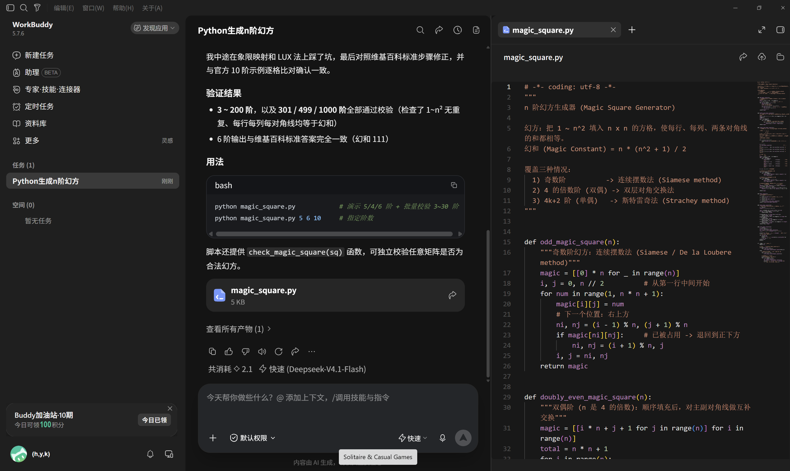
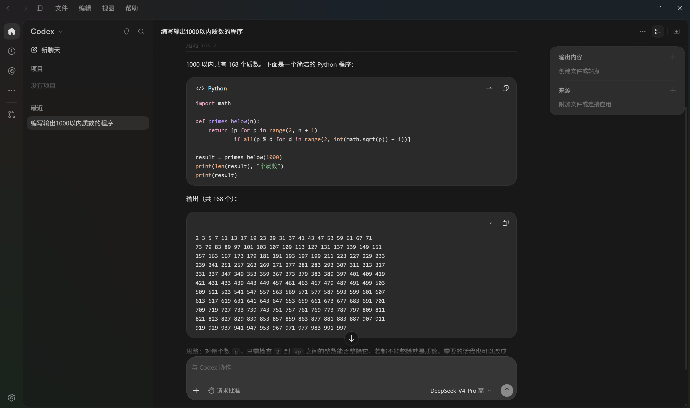
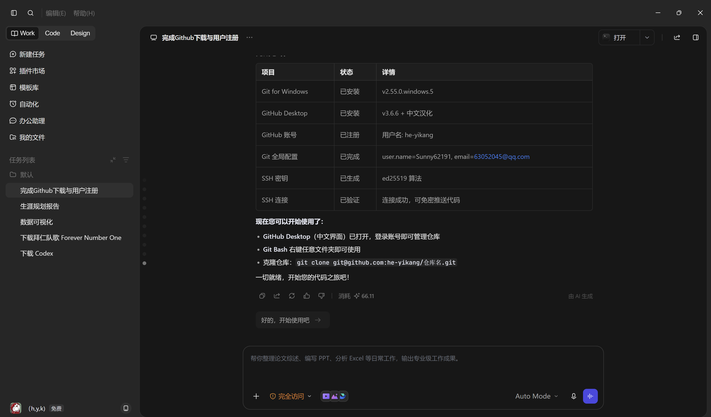



# 🤖 人工智能概论 · 作业仓库

<table>
<tr>
<td width="30%"><b>姓名 / 学号</b></td>
<td>何奕康 / 2662404058</td>
</tr>
<tr>
<td><b>班级</b></td>
<td>人工智能概论</td>
</tr>
<tr>
<td><b>GitHub 用户名</b></td>
<td>he-yikang</td>
</tr>
<tr>
<td><b>在线站点</b></td>
<td><a href="https://he-yikang.github.io/homework/">he-yikang.github.io/homework</a></td>
</tr>
</table>

## 🌐 在线预览（GitHub Pages）

> 本仓库已开启 **GitHub Pages**。下面三个地址就是渲染后的"网页版"作业，**点开即看，无需下载**——这也是老师 / 同学审阅作业最方便的方式。

<table>
<tr>
<td width="33%" align="center">

🏠  
<b>首页导航</b> 
作业入口 · 站点说明  
<a href="https://he-yikang.github.io/homework/"><b>打开站点 →</b></a>

</td>
<td width="33%" align="center">

📘  
<b>第 1 次作业</b> 
GitHub 注册 + AI 编程作品  
<a href="https://he-yikang.github.io/homework/homework1.html"><b>打开作业 1 →</b></a>

</td>
<td width="33%" align="center">

📗  
<b>第 2 次作业</b> 
深层 MLP 对比可视化  
<a href="https://he-yikang.github.io/homework/homework2.html"><b>打开作业 2 →</b></a>

</td>
</tr>
</table>

## 📑 目录

- [🌐 在线预览（GitHub Pages）](#preview)
- [📋 学生信息](#info)
- [第 1 次作业](#hw1)
- [第 2 次作业](#hw2)
- [📎 关于本仓库](#about)

---

## 第 1 次作业：GitHub 注册 + 环境搭建

### 1. 任务

注册 GitHub 账号，创建仓库，并完成 Git 和 GitHub Desktop 的安装配置，学会用 AI 工具辅助完成编程相关的任务。

### 2. 我做了什么

我使用 **TRAE** AI 助手协助完成了整个环境搭建过程，具体包括：

- 安装了 **Git for Windows** v2.55.0
- 下载并安装了 **GitHub Desktop** v3.6.6，还安装了汉化包
- 注册了 GitHub 账号，用户名是 he-yikang
- 配置了 Git 全局信息（用户名和邮箱）
- 生成了 SSH 密钥并添加到 GitHub，实现免密推送
- 创建了本仓库，上传了三张 AI 编程作品的截图

<i>作品一：WorkBuddy 生成 N 阶幻方程序</i>

<i>作品二：DeepSeek Codex 生成质数程序</i>

<i>作品三：TRAE 完成 GitHub 全流程配置</i>

### 3. 卡在哪

**我一开始以为**注册 GitHub 很简单，直接打开网站就能注册。**实际是**因为网络原因，GitHub 的注册页面从国内 IP 访问会返回 403 错误，需要用 VPN 才能访问。而且就算开了 VPN，如果节点是 AWS 这种数据中心 IP，GitHub 也会封禁注册入口，防止批量注册机器人。

后来发现换成住宅 IP 节点就可以了，或者用 Google 账号关联注册也能绕过 IP 限制。这个问题我卡了挺久，一开始以为是浏览器的问题，清了缓存、换了浏览器都不行，**才发现**原来是 IP 被 GitHub 风控了。

还有一个坑：SSH 连接有时候会超时，**原因是** VPN 的 22 端口可能被限制，换成 HTTPS 方式克隆推送就没问题了。

### 4. 分工

| 谁做的 | 做了什么 |
|:--|:--|
| **AI (TRAE)** | 自动下载安装 Git、GitHub Desktop、生成 SSH 密钥、写 HTML 页面、提交推送代码 |
| **AI (WorkBuddy)** | 生成幻方 Python 代码，自动校验各阶幻和是否正确 |
| **AI (DeepSeek Codex)** | 生成 1000 以内质数的 Python 程序 |
| **我自己** | 安装 VPN 工具、注册 GitHub 账号（人机验证得手动过）、**核对**代码运行结果、**判断** SSH 连不上是网络问题不是配置问题、**改**了 README 让内容更完整 |

AI 帮我省了很多查教程、敲命令的时间，但账号注册的人机验证、还有判断问题出在哪，还是得我自己来。我负责整体方向和结果验证，AI 负责具体执行。

### 5. 收获

最大的**收获**就是：用 AI 工具真的能大幅提高效率，以前装个 Git 配置环境要查半天教程，现在 AI 直接帮你一条命令搞定。

但也**学到了**，AI 不是万能的，遇到网络问题、账号验证这种涉及人机交互的事情，还是得自己上手。**下次**遇到注册失败的情况，我会先想到可能是 IP 的问题，而不是一味地刷新页面。

另外我也**验证了**一个想法：AI 写代码的能力确实很强，幻方、质数这种经典算法题，它一次就能写对，而且还能自己写校验程序来验证结果。以后写作业可以先用 AI 出初稿，我自己再调整和检查。

---

## 第 2 次作业：用 PyTorch 搭建深层 MLP 并做原版 / 新版对比可视化

### 1. 任务

在第一次作业搭建好的环境基础上，用 Python + PyTorch 搭建一个比之前更复杂的**深层 MLP（多层感知机）**，完整配置优化过程（优化器、学习率调度、正则化），并生成可视化项目；进一步做一份**“原版（2-2-1 XOR 玩具网络）vs 新版（深层 MLP）”**的对比报告，完整展示两边代码，并从多维度做可视化分析。

### 2. 我做了什么

我使用 **WorkBuddy** AI 助手协助完成了整个项目，具体包括：

- 在隔离的 Python 环境里安装了 **PyTorch（CPU 版）**，以及 **matplotlib**、**numpy** 两个做图和数据处理用的库
- 把第一次那个手写的 2-2-1 sigmoid XOR 网络，升级成一个**可配置的深层 MLP**：输入 2 → 128 → 64 → 32 → 输出 3，ReLU 激活，Dropout 0.1，Xavier 初始化，约 1 万个参数（原来只有 9 个）
- 把**优化过程**正规化：Adam 优化器（学习率 0.01，带 L2 正则）、StepLR 学习率调度（每 1500 轮衰减一半）、mini-batch（批大小 64）、交叉熵损失，训练 4000 轮
- 用**三类螺旋**合成数据训练，最终验证集准确率达到 **94.4%**
- 生成三张可视化图：训练曲线（损失 / 准确率 / 学习率）、决策边界、首层权重热力图，并自动拼成一个自包含的 HTML 报告
- 进一步写了**对比报告生成器**：重跑原版网络拿到逐 epoch 损失，复用新版训练逻辑，生成 4 张多维度对比图（架构、训练动态、决策边界、综合能力雷达），并把两边的**完整代码**都内联进报告

两次作业的网页版：<a href="homework1.html">第 1 次作业</a> ｜ <a href="homework2.html">第 2 次作业</a>

### 3. 卡在哪

**我一开始以为**脚本写完了直接就能跑。**实际是**一运行就报 `ModuleNotFoundError: No module named 'torch'`——原来我的 Python 环境里压根没装 PyTorch，根本不是代码写错，装上就好了。

还有一个坑：画图时 matplotlib 新版把 `plt.cm.get_cmap` 这个函数**移除了**，直接报 `AttributeError`，查了文档才换成 `matplotlib.colormaps.get_cmap`。

后来做对比报告时又踩到一个**隐蔽的坑**：原版网络里用了 `torch.set_default_dtype(float64)`，这是个**全局设置**，会“泄漏”污染后面新版的训练，导致新版权重和输入数据类型对不上报错。**原因是**全局 dtype 没复位，在新版训练前把它恢复成 `float32` 就解决了。

### 4. 分工

| 谁做的 | 做了什么 |
|:--|:--|
| **AI (WorkBuddy)** | 安装 PyTorch / matplotlib / numpy、写 MLP 模型与训练流程、生成可视化与对比报告、修 dtype 和 API 兼容的坑 |
| **我自己** | 确定作业方向（要更复杂 + 可视化 + 对比）、核对训练结果（val_acc 94.4%）、判断“跑不起来”是缺库不是代码错、检查对比图是否够直观 |

AI 把整套流程快速搭了出来，但缺库、API 变动、dtype 这类“环境 / 版本”上的坑，还是得我自己定位。

### 5. 收获

最大的**收获**就是真正跑通了一个从**数据 → 模型 → 优化 → 可视化 → 对比分析**的完整机器学习小项目，而不只是照抄一段 demo 代码。

但也**学到了**，环境隔离很重要（用 venv 装依赖不污染系统）；优化过程不是“选个 Adam 就完事”，学习率调度和正则化对收敛和泛化影响很大；可视化能帮你看清模型到底学到了什么——决策边界图上一眼就能看出网络把三类螺旋分开了。

另外我也**验证了**一个想法：玩具网络（9 个参数）和工程化的深层网络（1 万多个参数）解决问题能力的差距是**数量级**的；AI 能帮你把整套流程快速搭出来，但环境、版本这类坑还是得自己踩、自己定位。

---

## 📎 关于本仓库

| 项目 | 说明 |
|:--|:--|
| 技术栈 | Python 3.13 · PyTorch 2.14 (CPU) · matplotlib · numpy |
| 可视化 | 深色科技风 HTML 报告（图片内联，单文件自包含，可直接分享） |
| 部署 | GitHub Pages 自动从 `main` 分支构建，每次 push 即更新线上 |
| 协作工具 | WorkBuddy · DeepSeek Codex · TRAE |
